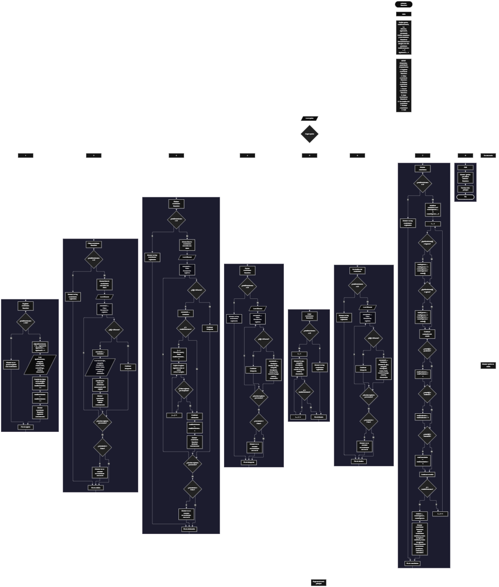

 

Este proyecto, llamado <b>asistente financiero</b>, fue desarrollado en <b>pseint</b> como un ejercicio práctico para fortalecer la lógica de programación mediante la creación de un sistema de gestión de movimientos financieros desde la consola. El programa cuenta con un menú principal de ocho opciones que permite <b>registrar, editar, eliminar, buscar, listar y consultar la información completa</b> de los movimientos financieros, además de mostrar estadísticas y finalizar la ejecución. Cada movimiento almacena datos como el tipo, la categoría, la descripción, el monto, la fecha, el método de pago, el estado y las observaciones, utilizando arreglos paralelos con una capacidad máxima de <b>100 movimientos durante la ejecución</b>. Durante su desarrollo se aplicaron conceptos fundamentales de programación, como variables, arreglos, estructuras condicionales, ciclos repetitivos y estructuras de selección, además de procesos para buscar, modificar, eliminar y reorganizar registros. También se implementaron contadores y acumuladores para calcular los ingresos, los egresos, el balance financiero y la cantidad de movimientos según su estado. Este proyecto permite poner en práctica los conocimientos adquiridos en PSeInt y sirve como base para desarrollar sistemas de gestión financiera más avanzados utilizando otros lenguajes y tecnologías.

<h2 align="center">⚙️ Funcionamiento del menú principal</h2>

### ➕ Registrar movimiento financiero

La opción <b>1) registrar movimiento financiero</b> permite registrar un nuevo movimiento en el sistema. Antes de realizar el registro, el programa comprueba que la variable <b>totalMovimientos</b> sea menor que <b>100</b>, utilizando la condición <b>totalMovimientos &lt; 100</b>. Si existe espacio disponible, asigna un identificador mediante la variable <b>siguienteID</b> y solicita el <b>tipo de movimiento, categoría, descripción, monto, fecha, método de pago, estado y observación</b>. Los datos se almacenan en la posición correspondiente de sus respectivos arreglos. Finalmente, aumenta la variable <b>totalMovimientos</b> en uno y muestra el mensaje <b>"movimiento financiero registrado correctamente."</b>. Si se alcanza la capacidad máxima, presenta el mensaje <b>"no se pueden registrar mas movimientos."</b>, impidiendo registrar otro movimiento mientras se mantengan los 100 registros.

### ✏️ Editar movimiento financiero

La opción <b>2) editar movimiento financiero</b> permite modificar la información de un movimiento registrado. Primero, el programa comprueba si existen movimientos almacenados mediante la variable <b>totalMovimientos</b>. Si no hay registros, muestra el mensaje <b>"no hay movimientos registrados."</b>. En caso contrario, presenta una lista con el ID, tipo de movimiento, categoría, descripción, monto, fecha, método de pago, estado y observación de cada registro. Después, solicita el ID del movimiento que se desea editar y utiliza la variable lógica <b>encontrado</b> para comprobar si existe una coincidencia. Si encuentra el identificador, solicita los nuevos datos y actualiza los valores de los arreglos correspondientes, conservando el ID original. Finalmente, presenta el mensaje <b>"movimiento financiero editado correctamente."</b>. Si el ID no coincide con ningún registro, muestra el mensaje <b>"no se encontro un movimiento con ese id."</b>.

### 🗑️ Eliminar movimiento financiero

La opción <b>3) eliminar movimiento financiero</b> permite eliminar un movimiento registrado mediante su identificador. Antes de comenzar, el programa comprueba que existan movimientos almacenados. Si no hay registros, muestra el mensaje <b>"no hay movimientos registrados."</b>. Si existen movimientos disponibles, presenta una lista con todos sus datos y solicita el ID del registro que se desea eliminar. A continuación, utiliza la variable lógica <b>encontrado</b> para determinar si existe una coincidencia. Si encuentra el movimiento y este no ocupa la última posición, utiliza un ciclo <b>para</b> controlado por la variable <b>j</b> para desplazar una posición hacia la izquierda los datos de los registros posteriores en los nueve arreglos: <b>id, tipoMovimiento, categoria, descripcion, monto, fecha, metodoPago, estado y observacion</b>. Posteriormente, disminuye la variable <b>totalMovimientos</b> en uno y muestra el mensaje <b>"movimiento financiero eliminado correctamente."</b>. Si no encuentra el identificador, presenta el mensaje <b>"no se encontro un movimiento con ese id."</b>. El código no limpia explícitamente la última posición después de eliminar un registro y continúa el recorrido del ciclo <b>para</b> aunque haya encontrado una coincidencia.

### 🔎 Buscar movimiento financiero

La opción <b>4) buscar movimiento financiero</b> permite localizar un movimiento mediante su ID. Primero, el programa comprueba si existen registros almacenados. Si no hay movimientos, muestra el mensaje <b>"no hay movimientos registrados."</b>. En caso contrario, solicita el identificador que se desea buscar e inicializa la variable lógica <b>encontrado</b> con el valor <b>falso</b>. Después, utiliza un ciclo <b>para</b> para recorrer los identificadores almacenados y compararlos con el valor introducido mediante la condición <b>id[i] = idBuscar</b>. Cuando encuentra una coincidencia, cambia la variable <b>encontrado</b> a <b>verdadero</b> y muestra todos los datos del movimiento, incluidos el monto, la fecha, el método de pago, el estado y la observación. Si finaliza el recorrido sin encontrar coincidencias, presenta el mensaje <b>"no se encontro un movimiento con ese id."</b>.

### 📋 Listar movimientos financieros

La opción <b>5) listar movimientos financieros</b> permite visualizar todos los movimientos registrados actualmente. Antes de mostrar la información, el programa comprueba si la variable <b>totalMovimientos</b> es igual a cero. Si no existen registros, presenta el mensaje <b>"no hay movimientos registrados."</b>. Si hay movimientos disponibles, utiliza un ciclo <b>para</b> para recorrer los arreglos desde la primera posición hasta el total actual de registros. Durante el recorrido, muestra el ID, tipo de movimiento, categoría, descripción, monto, fecha, método de pago, estado y observación de cada movimiento. Esta función facilita consultar los registros existentes sin necesidad de buscar cada movimiento individualmente.

### 📄 Ver detalles del movimiento financiero

La opción <b>6) ver detalles del movimiento financiero</b> permite consultar individualmente toda la información de un movimiento específico. Primero, el programa comprueba si existen registros almacenados. Si no hay movimientos, muestra el mensaje <b>"no hay movimientos registrados."</b>. En caso contrario, solicita el ID del movimiento que se desea consultar e inicializa la variable <b>encontrado</b> con el valor <b>falso</b>. Después, recorre los identificadores mediante un ciclo <b>para</b>. Si encuentra una coincidencia, cambia la variable a <b>verdadero</b> y muestra los datos completos del movimiento dentro de un bloque delimitado por separadores. La información presentada incluye el ID, tipo de movimiento, categoría, descripción, monto, fecha, método de pago, estado y observación. Si el identificador no corresponde a ningún registro, muestra el mensaje <b>"no se encontro un movimiento con ese id."</b>.

### 📊 Mostrar estadísticas

La opción <b>7) mostrar estadisticas</b> permite obtener un resumen de los movimientos financieros registrados. Primero, el programa comprueba si existen movimientos almacenados. Si no hay registros, muestra el mensaje <b>"no hay movimientos registrados."</b>. En caso contrario, inicializa los contadores <b>totalIngresos, totalEgresos, totalPendientes, totalRealizados y totalCancelados</b>, además de los acumuladores <b>montoIngresos</b> y <b>montoEgresos</b>, con el valor cero. Después, utiliza un ciclo <b>para</b> para recorrer los movimientos. Cuando el tipo de movimiento es exactamente <b>"ingreso"</b>, aumenta el contador de ingresos y acumula su monto. Cuando el tipo es exactamente <b>"egreso"</b>, aumenta el contador de egresos y acumula su monto. También cuenta los movimientos cuyos estados coinciden exactamente con <b>"pendiente"</b>, <b>"realizado"</b> o <b>"cancelado"</b>. Al finalizar el recorrido, calcula el balance mediante la operación <b>montoIngresos - montoEgresos</b> y presenta el total de movimientos, la cantidad de ingresos y egresos, los montos acumulados, el balance financiero y los contadores correspondientes a cada estado. Los montos se acumulan según el tipo de movimiento, independientemente de su estado.

### 🚪 Salir del menú principal

La opción <b>8) salir</b> está destinada a finalizar la ejecución del programa y muestra el mensaje <b>"gracias por utilizar asistente financiero."</b>. El menú principal se encuentra dentro de una estructura repetitiva <b>repetir ... hasta que</b>, cuya condición de salida es <b>hasta que opcion = 8</b>. Por lo tanto, al seleccionar la opción 8, el ciclo termina y el programa finaliza su ejecución. Si el usuario introduce un valor que no coincide con las opciones definidas, la estructura <b>segun</b> ejecuta el bloque <b>de otro modo</b> y muestra el mensaje <b>"opcion no valida."</b>.

<h2 align="center">🧠 Temas aplicados en el proyecto</h2>

### 📦 Variables

En este proyecto se utilizan variables para controlar la opción seleccionada en el menú, almacenar la cantidad de movimientos registrados, generar identificadores, recorrer los arreglos, localizar registros, controlar las operaciones de edición y eliminación y calcular las estadísticas financieras. También se utilizan variables de tipo real para almacenar los montos monetarios y el balance, así como variables de tipo cadena para representar los datos descriptivos de cada movimiento.

🔢 **Opcion:** Almacena la opción seleccionada por el usuario en el menú principal.

📊 **TotalMovimientos:** Almacena la cantidad actual de movimientos registrados.

🆔 **SiguienteID:** Genera los identificadores consecutivos asignados a los nuevos movimientos.

🔎 **IDBuscar:** Almacena el identificador introducido para buscar, editar o eliminar un movimiento, o consultar sus detalles.

🔄 **I:** Funciona como contador para recorrer los movimientos almacenados en los arreglos.

🔁 **J:** Controla el recorrido utilizado para desplazar los datos durante la eliminación de un movimiento.

✅ **Encontrado:** Variable lógica que indica si se localizó el movimiento solicitado.

💰 **Monto:** Almacena el valor monetario de cada movimiento financiero.

📈 **MontoIngresos y MontoEgresos:** Acumulan los montos correspondientes a los ingresos y egresos reconocidos durante el cálculo de las estadísticas.

⚖️ **Balance:** Almacena la diferencia entre el monto total de los ingresos y el monto total de los egresos reconocidos.

📊 **TotalIngresos y TotalEgresos:** Cuentan los movimientos identificados como ingresos y egresos.

📋 **TotalPendientes, TotalRealizados y TotalCancelados:** Cuentan los movimientos cuyos estados coinciden con los valores esperados.

### 🗃️ Arreglos

En este proyecto se utilizan nueve arreglos paralelos para almacenar la información de cada movimiento financiero. Cada arreglo tiene una capacidad de <b>100 posiciones</b> y utiliza el mismo índice para representar los datos correspondientes a un mismo movimiento. Por ejemplo, los datos del registro almacenado en la posición <b>1</b> se encuentran distribuidos entre <b>id[1], tipoMovimiento[1], categoria[1], descripcion[1], monto[1], fecha[1], metodoPago[1], estado[1] y observacion[1]</b>. Esta organización permite recorrer, buscar, modificar, mostrar y eliminar los registros manteniendo la correspondencia entre sus datos.

🆔 **Id[100]:** Almacena los identificadores de los movimientos financieros.

🔄 **TipoMovimiento[100]:** Almacena el tipo de movimiento, como ingreso o egreso.

🗂️ **Categoria[100]:** Almacena la categoría correspondiente a cada movimiento.

📝 **Descripcion[100]:** Almacena la descripción del movimiento financiero.

💰 **Monto[100]:** Almacena el valor monetario de cada movimiento.

📅 **Fecha[100]:** Almacena la fecha del movimiento.

💳 **MetodoPago[100]:** Almacena el método de pago utilizado.

📋 **Estado[100]:** Almacena el estado del movimiento financiero.

📌 **Observacion[100]:** Almacena las observaciones adicionales de cada registro.

### 🔀 Estructuras condicionales

En este proyecto se utilizan las estructuras <b>si</b> y <b>sino</b> para comprobar si existen movimientos registrados, controlar la capacidad máxima antes de agregar un nuevo registro, verificar si se encuentra un identificador, determinar si es necesario desplazar los arreglos durante una eliminación y clasificar los movimientos para calcular las estadísticas. Estas condiciones permiten que el programa ejecute diferentes instrucciones según la información almacenada y los resultados de cada comprobación.

### 🔄 Estructuras repetitivas

En este proyecto se utilizan los ciclos <b>para</b> y <b>repetir ... hasta que</b>. Los ciclos <b>para</b> permiten recorrer los arreglos para mostrar los movimientos, buscar identificadores, modificar registros y calcular las estadísticas. Durante la eliminación, también se utiliza un ciclo <b>para</b> controlado por la variable <b>j</b> para desplazar los datos posteriores una posición hacia la izquierda. Por otro lado, el ciclo <b>repetir ... hasta que</b> mantiene activo el menú principal hasta que el usuario selecciona la opción <b>8</b>, permitiendo ejecutar varias operaciones antes de finalizar el programa.

### 🎯 Estructura según

El programa utiliza la estructura <b>segun</b> para evaluar el valor almacenado en la variable <b>opcion</b> y ejecutar el bloque de instrucciones correspondiente. Cada caso representa una operación específica del sistema: <b>registrar, editar, eliminar, buscar, listar, ver detalles, mostrar estadísticas o salir</b>. También se utiliza el bloque <b>de otro modo</b> para mostrar el mensaje <b>"opcion no valida."</b> cuando el valor introducido no coincide con ninguna de las opciones definidas en el menú principal.

### 🔢 Dimensionamiento de arreglos

El programa utiliza la instrucción <b>dimension</b> para establecer la capacidad de los nueve arreglos que almacenan la información de los movimientos financieros. Cada arreglo dispone de <b>100 posiciones</b>, lo que permite registrar hasta 100 movimientos durante la ejecución. La cantidad de posiciones ocupadas se controla mediante la variable <b>totalMovimientos</b>, mientras que la condición <b>totalMovimientos &lt; 100</b> impide registrar nuevos movimientos cuando se alcanza el límite establecido.

### 🔄 Reorganización de registros

Cuando se elimina un movimiento que no ocupa la última posición, el programa utiliza un ciclo <b>para</b> que comienza en la posición seleccionada y llega hasta <b>totalMovimientos - 1</b>. En cada repetición, los datos de la posición siguiente se copian sobre la posición actual en los nueve arreglos: <b>id, tipoMovimiento, categoria, descripcion, monto, fecha, metodoPago, estado y observacion</b>. Después, la variable <b>totalMovimientos</b> disminuye en uno. Este procedimiento permite mantener juntos los datos de cada registro y reorganizar las posiciones activas de los arreglos. El código no limpia explícitamente la última posición que queda fuera del total actualizado.

### 📊 Contadores y acumuladores

El cálculo de las estadísticas utiliza contadores para registrar cuántos movimientos corresponden a cada tipo o estado y acumuladores para sumar los montos reconocidos como ingresos y egresos. Antes del recorrido, estas variables se inicializan en cero. A continuación, el ciclo <b>para</b> examina cada movimiento y actualiza los valores según las condiciones establecidas. Finalmente, el programa calcula el balance financiero restando el total acumulado de egresos al total acumulado de ingresos. Los contadores de estado se calculan de forma independiente y no determinan qué montos se incluyen en los acumuladores.

<h2 align="center">¿Cómo se implementaron las operaciones crud en el proyecto?</h2>

Las operaciones <b>crud</b> se implementaron mediante las opciones del menú principal, permitiendo administrar los movimientos financieros registrados. La operación <b>crear</b> corresponde a <b>registrar movimiento financiero</b>, donde se introducen los datos de un nuevo movimiento; <b>leer</b> se realiza mediante las opciones <b>buscar movimiento financiero, listar movimientos financieros y ver detalles del movimiento financiero</b>; <b>actualizar</b> corresponde a <b>editar movimiento financiero</b>, donde se modifican los datos de un registro existente; y <b>eliminar</b> se realiza mediante la opción <b>eliminar movimiento financiero</b>. Estas operaciones utilizan variables, arreglos, condicionales y ciclos para administrar la información almacenada temporalmente durante la ejecución del programa.

<h2 align="center">Diagrama de flujo del proyecto</h2>

<h2 align="center">🛡️ Validaciones del programa</h2>

### 📭 No existen movimientos registrados

Esta comprobación se utiliza en las opciones de <b>editar, eliminar, buscar, listar, ver detalles y mostrar estadísticas</b>. El programa verifica si la variable <b>totalMovimientos</b> es igual a <b>0</b> y, si no existen registros, muestra el mensaje <b>"no hay movimientos registrados."</b>. Esta comprobación evita continuar con las operaciones que necesitan información almacenada cuando el sistema está vacío.

### ⚠️ Capacidad máxima alcanzada

Esta validación se utiliza durante el registro de nuevos movimientos para controlar la capacidad de los arreglos. El programa comprueba si <b>totalMovimientos &lt; 100</b> antes de permitir agregar un registro. Si existe espacio disponible, solicita los datos y aumenta el contador de movimientos. En caso contrario, muestra el mensaje <b>"no se pueden registrar mas movimientos."</b>, impidiendo agregar otro registro cuando se alcanza la capacidad máxima.

### ❌ Movimiento no encontrado

Esta comprobación se utiliza durante las operaciones de edición, eliminación, búsqueda y consulta de detalles. El programa inicializa la variable lógica <b>encontrado</b> con el valor <b>falso</b> y recorre los identificadores almacenados para compararlos con el valor introducido por el usuario. Cuando encuentra una coincidencia, cambia la variable a <b>verdadero</b> y ejecuta la operación correspondiente. Si al finalizar el recorrido la variable continúa siendo <b>falso</b>, muestra el mensaje <b>"no se encontro un movimiento con ese id."</b>.

### 🔢 Identificadores consecutivos

El programa utiliza la variable <b>siguienteID</b> para asignar un identificador a cada movimiento nuevo. Inicialmente, esta variable tiene el valor <b>1</b>. Después de asignar el identificador al registro, aumenta en uno para que el siguiente movimiento reciba un nuevo ID. Durante la edición, el identificador original se conserva, mientras que la eliminación desplaza los identificadores de los registros posteriores junto con los demás datos. El código no reutiliza explícitamente los identificadores de los movimientos eliminados.

### ⚠️ Tipos y estados de los movimientos

Durante el cálculo de las estadísticas, el programa compara los tipos y estados almacenados con textos específicos. Para contabilizar los ingresos y egresos, utiliza las comparaciones <b>tipoMovimiento[i] = "ingreso"</b> y <b>tipoMovimiento[i] = "egreso"</b>. Para los estados, utiliza <b>estado[i] = "pendiente"</b>, <b>estado[i] = "realizado"</b> y <b>estado[i] = "cancelado"</b>. Sin embargo, el código no comprueba estos valores durante el registro o la edición. Por esta razón, un tipo o estado diferente de los textos esperados no se contabiliza en las categorías correspondientes, aunque el movimiento permanezca almacenado.

### ⚠️ Opción inválida

La estructura <b>segun</b> incluye el bloque <b>de otro modo</b>, que muestra el mensaje <b>"opcion no valida."</b> cuando el usuario introduce un valor que no corresponde a ninguna de las opciones definidas en el menú principal. Esta respuesta permite informar que la opción seleccionada no coincide con las operaciones disponibles.

<h2 align="center">🎯 Objetivo del proyecto</h2>

El objetivo principal de este proyecto es fortalecer la <b>lógica de programación</b> mediante el desarrollo de un sistema de gestión de movimientos financieros en <b>pseint</b>. A través de su construcción se busca aplicar los conocimientos adquiridos sobre variables, arreglos, estructuras condicionales, ciclos repetitivos y estructuras de selección, integrándolos para resolver un problema de manera organizada. Además, el proyecto permite comprender cómo registrar, consultar, modificar y eliminar información, así como utilizar contadores y acumuladores para obtener estadísticas sobre los ingresos, los egresos, el balance financiero y los estados de los movimientos. De esta manera, se establece una base para desarrollar sistemas de gestión financiera más completos con otros lenguajes y tecnologías.

